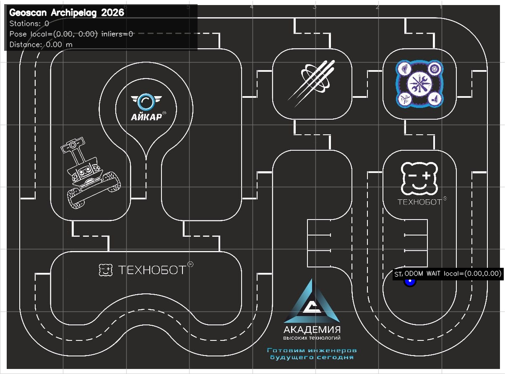
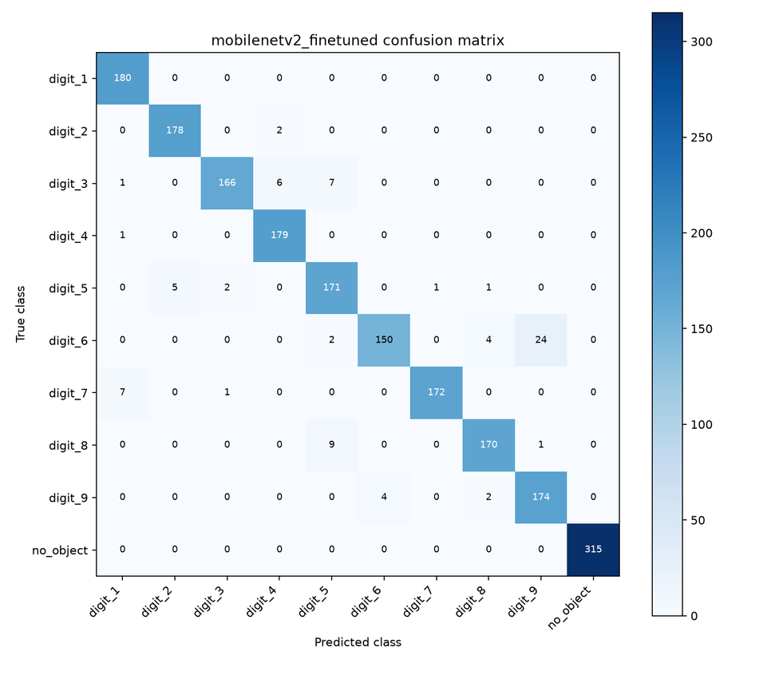

# Архипелаг 2026 · Видеоинспекция с БПЛА

Три трека решают задачи учёта маркированных судов, поиска объекта с маркером и осмотра солнечных панелей. Для инспекции инфраструктуры наиболее близок третий трек. Бортовой код оценивает загрязнение панели, объединяет повторные наблюдения и передаёт ID, статус и локальные координаты на операторскую карту.



*Кадр из программы карты на комплектном плане поля 8 × 6 м. Это начальное состояние до поступления телеметрии. Число обнаруженных станций равно нулю.*

## Три трека

| Трек | Вход и обработка | Результат |
| --- | --- | --- |
| **1. Учёт судов** | YOLO выделяет суда на видео. В расширенной области вокруг рамки OpenCV ищет ArUco семейства 4×4. ID маркера связывает наблюдения во времени, сумма confidence помогает выбрать класс. В весах классы называются `green` и `orange`, в отчёте скрипта — зарегистрированное и незарегистрированное судно. | Аннотированное видео и список подтверждённых судов по ID. [Офлайн-обработка](1_track/final/aruco_yolo_robust.py) · [Бортовой вариант RKNN](1_track/final/scripts/yolo_aruco_vessels.py) |
| **2. Маркер и цифры** | В финале выделяется светлый прямоугольник по HSV и геометрии контура, затем внутри ищется ArUco ID 5. В отборе решалась отдельная задача — классификация цифр 1–9 на подводном «чёрном ящике» и класса `no_object`. Есть генератор синтетических кубов и обучение MobileNet в Keras. | Для видео — маска и найденная область с маркером. Для изображения — три наиболее вероятных класса. [Анализ видео](2_track/final/camera/work.py) · [Генератор](2_track/otbor/scripts/cube_gen.py) · [Классификатор](2_track/otbor/А2026-ИИ-Ёжики_на_паскале/neural_network_project/) |
| **3. Осмотр панелей** | YOLO распознаёт `dust` и `solar panel`. На борту код связывает загрязнение с панелью по геометрии рамок и при зависании накапливает наблюдения. Повторные обнаружения вблизи усредняются. | Координаты в метрах, статус, средняя уверенность и число подтверждений отправляются по HTTP. Станция оператора рисует объекты и путь на плане. [Бортовая обработка](3_track/flight_panel_mapping_fixed.py) · [Карта](3_track/map_flight.py) |

### Как панель попадает на карту

В точке сканирования код прибавляет к координатам заданной маршрутной точки смещение центра рамки от центра изображения. Смещение пересчитывается из пикселей в метры по калибровочным коэффициентам. После восьми наблюдений трек может быть отправлен на `/drone`. Для подтверждения пыли нужны минимум два голоса и доля не менее 0,25. Статус «исправна» здесь означает отсутствие подтверждённого загрязнения. Электрическое состояние панели система не измеряет.

Отдельный поток `/pose` передаёт оценку движения для отрисовки траектории. В системе карты старт имеет координаты (1,5 м, 4,5 м). Это локальная привязка к полю. В проверке границ бортового маршрута и в `map_flight.py` знак преобразования локальной оси Y различается. Для полевого применения ориентацию нужно сверить по контрольным точкам. В [экспериментальном варианте карты](3_track/map_fixed_random_fallback.py) выход за границу может заменяться случайной позицией. Иллюстрация выше получена обычной картой.

## Результат, который можно проверить без дрона



Для дообученной MobileNetV2 сохранены **accuracy 95,87% и macro-F1 0,9553** на 1 935 тестовых изображениях. Из 180 шестёрок модель классифицировала 150 верно и 24 приняла за девятки. В сценарии обучения тестовая выборка участвует и в выборе модели. Метрики относятся только к классификатору второго трека. [Метрики, отчёт и исходная матрица](2_track/otbor/А2026-ИИ-Ёжики_на_паскале/neural_network_project/metrics/)

Команды из корня репозитория, macOS/Linux. На комплектном синтетическом примере сохранённая модель предсказывает `digit_6` с confidence 0,851269. Картинка получена генератором этого проекта. [Вход классификатора](docs/images/cube-6.jpg)

```bash
python3.11 -m venv .venv
source .venv/bin/activate
python -m pip install tensorflow==2.16.2 keras==3.15.1 pillow
model_dir="2_track/otbor/А2026-ИИ-Ёжики_на_паскале/neural_network_project"
python "$model_dir/predict.py" --model models/mobilenetv2_finetuned_best.h5 \
  --image "$PWD/docs/images/cube-6.jpg"
```

### Карта и видео

Для карты в отдельном окружении Python 3.11 установите `opencv-contrib-python==4.12.0.88 numpy==2.2.6 flask` через `python -m pip install`. Запустите `python 3_track/map_flight.py` в графической сессии. Откроется комплектный план, HTTP-приёмник слушает порт 5001. При наличии собственного плана `3_track/image.jpg` программа возьмёт его. `Esc` закрывает окно. Карту, приём сообщений и отрисовку проверили локально.

Для двух офлайн-детекторов проверено отдельное окружение Python 3.12 с `ultralytics==8.3.233` и `opencv-python==4.14.0.94`. Укажите свой видеоролик соответствующего трека вместо примера пути в кавычках.

```bash
python 1_track/final/aruco_yolo_robust.py --model 1_track/final/weights/best.pt \
  --video "/путь/к/судам.mp4" --output vessels.mp4 --no-display
python 3_track/model/run_yolo.py --model 3_track/model/best.pt \
  --source "/путь/к/панелям.mp4" --output panels.mp4 --device cpu --no-show
```

Оба скрипта загрузили свои веса и записали выходное видео при проверке на трёх технических кадрах. Полевые записи, эталонные координаты и оценка качества детекции судов или панелей в ветке отсутствуют. Для бортовых сценариев нужны совместимый Pioneer, камера, `pioneer_sdk2` и, для RKNN, соответствующая платформа и `pioneer_rknn`. Полёт и точность координат на оборудовании не проверялись.

**Навыки для задачи городской инспекции.** Объединение рамок и маркеров в реестр объектов, оценка видимого состояния, преобразование систем координат и передача наблюдений на карту.
